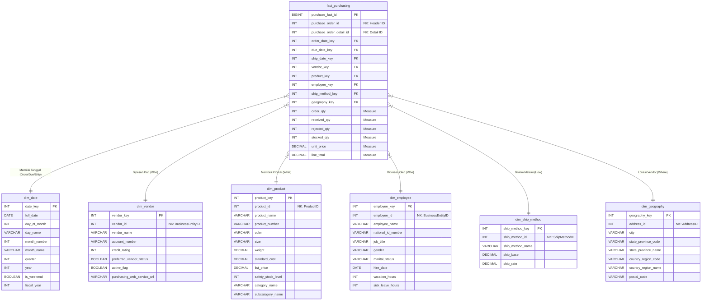

# ERD Data Warehouse Purchasing

Diagram star schema untuk proses pembelian (purchasing), dengan `fact_purchasing` sebagai tabel fakta dan empat tabel dimensi.

## Grain

**Satu baris pada `fact_purchasing` merepresentasikan satu item produk (detail baris) dalam satu purchase order, yaitu satu kombinasi `purchase_order_id` dan `purchase_order_detail_id`.**

## Keterangan

* **PK**: Primary Key (surrogate key)
* **FK**: Foreign Key ke tabel dimensi
* **NK**: Natural Key dari sistem sumber
* **Measure**: kolom ukuran (nilai numerik) pada tabel fakta
